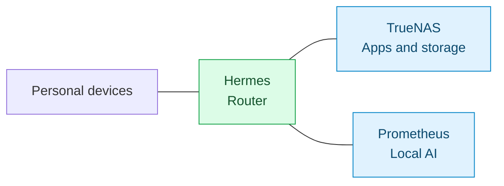

# Homelab

[Architecture](#architecture) · [Services](#what-i-run) · [Photos](#hardware-gallery) · [Documentation](#documentation)

I run my personal cloud on a repurposed gaming PC with [TrueNAS](https://www.truenas.com/truenas-community-edition/). It holds my photos, files, notes, passwords, and media. A second machine, Prometheus, runs local AI models on an AMD GPU.

I started this to replace recurring subscriptions and have more control over my data. This repository documents what I've built, how it works, and how I maintain it. Application configurations live alongside the documentation; runtime data and credentials stay outside Git.

## Architecture

Hermes connects the lab, TrueNAS hosts applications and data, and Prometheus runs local AI. The [networking guide](docs/networking.md) explains network separation and local/remote access.

## What I run

| Area | Services |
| --- | --- |
| Personal cloud | Nextcloud for files, calendar, contacts, and bookmarks; Immich for photos and videos; Vaultwarden for passwords |
| Notes and budgeting | Joplin Server for notes synchronization; Actual Budget with SimpleFIN imports |
| Media | Jellyfin for movies and TV; Audiobookshelf for purchased audiobooks; Navidrome for music |
| Personal projects | Crafty 4 for Minecraft; LubeLogger for truck maintenance, modifications, and fuel |
| Local AI | Open WebUI on TrueNAS, connected to Strata on Prometheus |
| Supporting services | Caddy, code-server, SearXNG, and qBittorrent with Gluetun/PIA |

The [service guide](docs/services.md) covers dependencies, clients, and links to all 15 Compose stacks. The [decisions and lessons](docs/decisions-and-lessons.md) explain the hardware reuse, storage design, and subscriptions this setup replaces.

## Hardware gallery

Click a photo to view it larger.

<table>
  <tr>
    <td width="33%" valign="top">
       
      <strong>The starting point</strong> 
      Gaming PC before the TrueNAS conversion.
    </td>
    <td width="33%" valign="top">
       
      <strong>Mirrored storage</strong> 
      Two 6 TB WD Red Plus data drives.
    </td>
    <td width="33%" valign="top">
       
      <strong>The conversion</strong> 
      Case disassembled for the upgrades.
    </td>
  </tr>
</table>

## Documentation

### Explore the setup

- [Infrastructure](docs/infrastructure.md): hardware, storage roles, and dataset layout.
- [Networking and access](docs/networking.md): network segments, DNS, private HTTPS, and WireGuard.
- [Services and clients](docs/services.md): applications, dependencies, media storage, and everyday use.
- [Local AI](docs/local-ai.md): serving architecture, the Q2_0 benchmark, and runtime details.
- [Backups and snapshots](docs/backups.md): protection coverage, schedules, and verification status.

### Maintain the lab

- [Operations and troubleshooting](docs/operations.md): deployment workflow, shell contexts, and diagnostic procedures.
- [PostgreSQL recovery](docs/POSTGRES_RECOVERY.md): select, validate, and restore a database backup.
- [Roadmap](docs/roadmap.md): outstanding checks and planned improvements.

### Background

- [Decisions and lessons](docs/decisions-and-lessons.md): why the lab is designed this way.
- [Migration history](docs/migrations.md): completed changes and the problems encountered along the way.

## Current status

The storage migration, three-network setup, phone HTTPS access, and Prometheus reboot startup are working. The standard Q2_0 benchmark is complete.

Local snapshots and daily PostgreSQL jobs were configured on November 4, 2026; initial snapshots and a manual backup succeeded. Unattended execution, a full restore test, email alerts, and an offsite copy remain follow-ups. Media automation with an *Arr stack is still planned.
