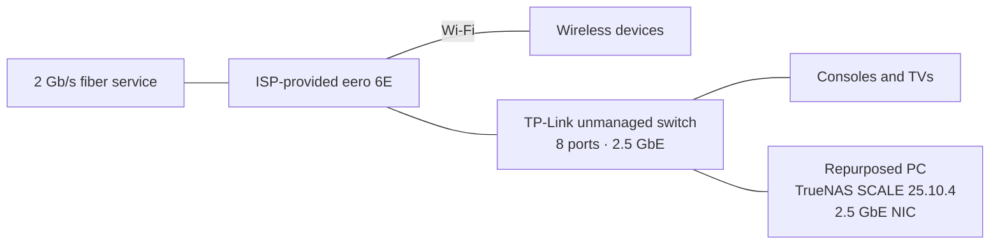

# Homelab

My homelab brings everyday services back under my control: photos, files, notes, passwords, media, and personal tools. A repurposed gaming PC running TrueNAS SCALE is the foundation.

I was tired of recurring subscriptions and relying on large companies to hold my important data. I wanted ownership and control over both the data and the services I use. That is what digital sovereignty means to me here.

I do not expect perfect privacy. This is a series of small, practical steps toward reducing how much of my life depends on third-party services and making choices I feel more comfortable with.

This repository documents the system I actually use, the decisions behind it, and the work still ahead. It also serves as a technical portfolio of my hands-on experience with self-hosting, storage, networking, and systems administration.

## Subscription spending avoided

An approximate comparison using US monthly list prices checked in October 2026, rather than my historical bills. Annual figures assume 12 monthly payments, before tax or discounts.

| Subscription replaced | Homelab alternative | Monthly estimate | Annual estimate |
| --- | --- | ---: | ---: |
| Google One 100 GB | Immich and Nextcloud for photo and file workflows | $1.99 | $23.88 |
| YouTube Music Premium, individual | Navidrome | $11.99 | $143.88 |
| A couple of streaming services | Jellyfin | Not quantified | Not quantified |
| **Subtotal of priced subscriptions** | | **$13.98** | **$167.76** |

Price references: [Google One pricing overview](https://www.androidcentral.com/google-one) and [YouTube Music's 2026 US price change](https://9to5google.com/2026/04/10/youtube-premium-us-price-hike/). The streaming services and their tiers have not been specified, so their additional savings are excluded. This is avoided subscription spending, not net savings: electricity, hardware, maintenance, and remaining paid services have not been costed. Self-hosting replaces my workflows, not the providers' entire catalogs or feature sets.

## Current architecture

Most devices use eero Wi-Fi; some consoles and TVs are wired to the switch. My devices usually access services over the LAN at home and through Tailscale elsewhere, though some use Tailscale automatically in either location. Tailscale Serve provides private service URLs and HTTPS where needed.

The reported 1 Gb/s bottleneck is the eero-to-switch connection. Addresses and internal service mappings are omitted.

## What I run

| Area | Current services and workflows |
| --- | --- |
| Personal data | Nextcloud for files, calendar, contacts, and bookmarks; Immich for automatic photo and video backups from personal devices; Vaultwarden for passwords |
| Notes and budgeting | [Joplin](https://github.com/laurent22/joplin) Markdown notes synced through Nextcloud; Actual Budget with SimpleFIN transaction imports |
| Media | Jellyfin for movies and TV, Audiobookshelf for purchased audiobooks, Navidrome for music |
| Personal projects | Crafty 4 for a Minecraft server; LubeLogger for truck maintenance, modifications, and fuel |
| Supporting infrastructure | Tailscale, AdGuard Home, File Browser, and qBittorrent with Gluetun/PIA, Jackett, and FlareSolverr |

The services are used through web interfaces and dedicated clients. Examples include [DAVx5](https://github.com/bitfireAT/davx5-ose) and [floccus](https://github.com/floccusaddon/floccus) with Nextcloud, [Navic](https://github.com/ssalggnikool/Navic) with Navidrome, and [AFinity](https://github.com/MakD/AFinity) with Jellyfin. I also built and use [LubeLogger-Android](https://github.com/AldogPlays/LubeLogger-Android) with my hosted LubeLogger instance.

## Subscription costs avoided

An illustrative estimate using U.S. monthly prices checked October 12, 2026. The plan tiers below are assumptions, not a record of my former bills.

| Subscription dropped | Assumed plan | Monthly | Annualized |
| --- | --- | ---: | ---: |
| [Google One](https://one.google.com/about/plans?g1_landing_page=1&g1_last_touchpoint=39) | 100 GB | $1.99 | $23.88 |
| [YouTube Music Premium](https://www.musicbusinessworldwide.com/youtube-hikes-us-subscription-prices-across-premium-and-music-plans/) | Individual | $11.99 | $143.88 |
| [Netflix](https://www.netflix.com/browse/genre/81701343) | Standard with ads | $8.99 | $107.88 |
| [Disney+](https://9to5google.com/2026/09/23/disney-plus-price-hike-september-2026/) | With ads, new-subscriber rate | $12.49 | $149.88 |
| **Estimated spending avoided** | | **$35.46** | **$425.52** |

Annualized amounts are monthly prices multiplied by 12. This excludes taxes, discounts, hardware, electricity, maintenance, and remaining paid services such as PIA and SimpleFIN. It is not a net-savings calculation or a claim that self-hosted libraries offer the same catalogs as streaming subscriptions.

## Decisions worth exploring

- **Reuse existing hardware:** upgraded the former gaming PC's memory and storage, added a 2.5 GbE NIC, and removed its discrete GPU.
- **Separate storage roles:** a dedicated SSD boots TrueNAS; two 6 TB HDDs form a mirrored data pool.
- **Keep filtering personal:** AdGuard Home is used with Tailscale for my devices after network-wide DNS filtering interfered with family use.
- **Connect services to daily workflows:** self-hosted services replace Google Photos, YouTube Music, Audible, and other cloud-dependent workflows.

See [decisions and lessons](docs/decisions-and-lessons.md) for the reasoning and tradeoffs.

## Limitations and next steps

**There are currently no independent backups or snapshots.** The HDD mirror provides disk redundancy, not a separate recoverable copy of my data. A backup system and snapshot strategy are the highest-priority planned improvements. Device uploads to Immich do not provide an independent backup of the server.

Other planned work includes a router capable of 2.5 Gb/s throughput, a possible transition of the eero to access-point use, an *Arr stack, and a broader networking refactor. These are plans, not implemented features.

## Documentation

| Document | What it covers |
| --- | --- |
| [Infrastructure](docs/infrastructure.md) | Hardware, storage, platform, and current networking |
| [Services and clients](docs/services.md) | Service purposes, deployment, Android clients, and integrations |
| [Decisions and lessons](docs/decisions-and-lessons.md) | Motivations, tradeoffs, and observed challenges |
| [Roadmap](docs/roadmap.md) | Planned improvements and unresolved details |

This baseline reflects the initial inventory. Real hardware photos can be added when available; no personal screenshots or fabricated hardware images are included.
