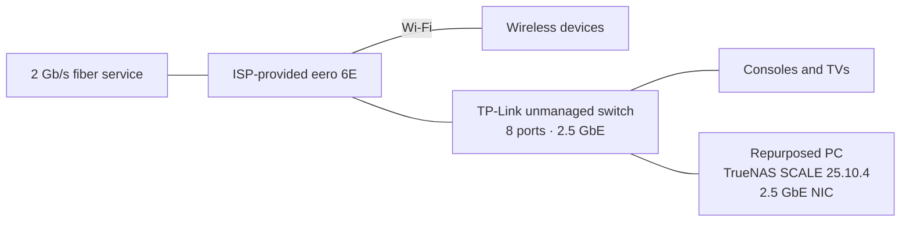
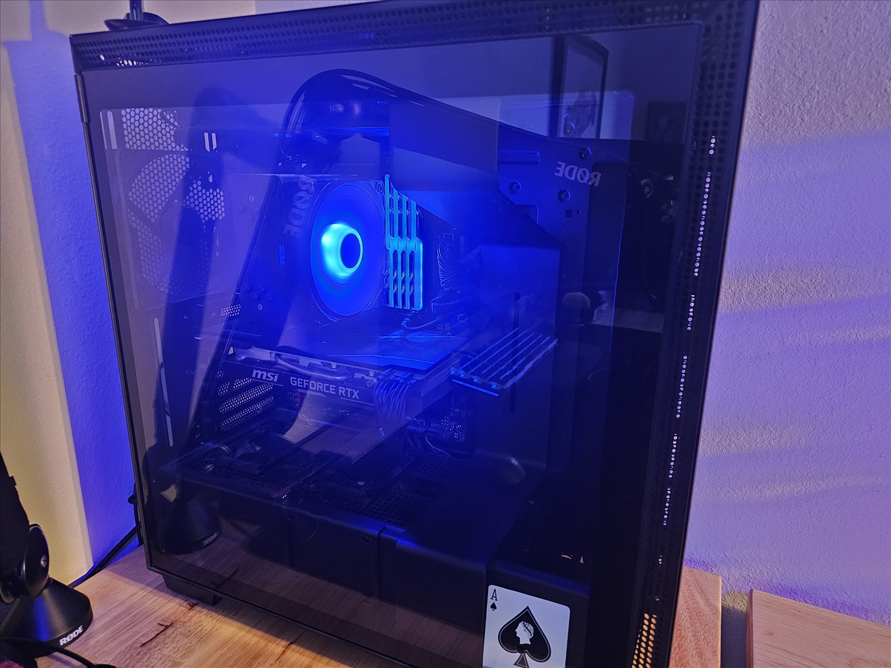
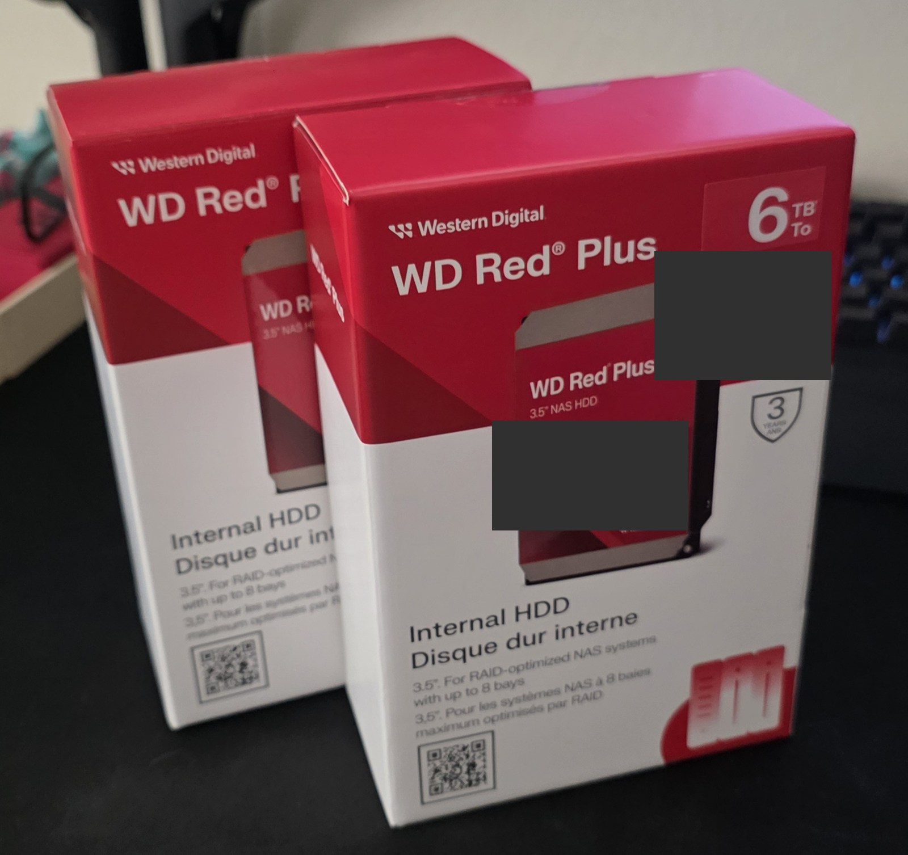
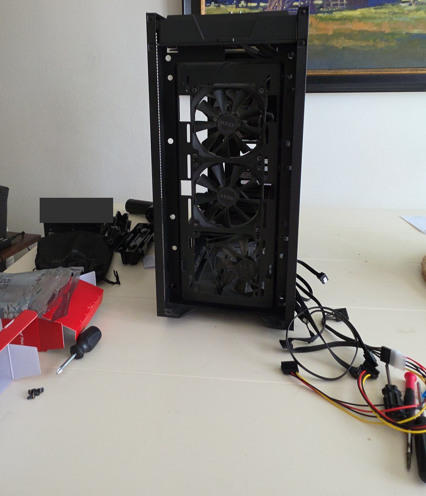

# Homelab

I run my personal cloud on a repurposed gaming PC with TrueNAS SCALE. It holds my photos, files, notes, passwords, and media, along with a few tools I use every day.

I started this because I was tired of recurring subscriptions and trusting large companies with my important data. I wanted to own more of the technology I depend on. For me, that's the point of digital sovereignty.

I don't expect perfect privacy, but I can take small steps to reduce tracking and choose where my data lives.

This repository is my record of the setup, what I've learned, and what I still need to improve. It also shows how I put my interests in networking, storage, and systems administration into practice.

## Current architecture

Most devices use eero Wi-Fi; some consoles and TVs are wired to the switch. My devices usually access services over the LAN at home and through Tailscale elsewhere, though some use Tailscale automatically in either location. Tailscale Serve provides private service URLs and HTTPS where needed.

The current bottleneck is the eero-to-switch connection, which is limited to 1 Gb/s.

## Hardware Gallery

Click a photo to view it larger.

<table>
  <tr>
    <td width="33%" valign="top">
       
      Gaming PC before TrueNAS, GPU removal, and storage upgrades.
    </td>
    <td width="33%" valign="top">
       
      Two 6 TB WD Red Plus drives for the mirrored pool.
    </td>
    <td width="33%" valign="top">
       
      Case disassembled during the conversion.
    </td>
  </tr>
</table>

## What I run

| Area | Current services and workflows |
| --- | --- |
| Personal data | Nextcloud for files, calendar, contacts, and bookmarks; Immich for automatic photo and video uploads; Vaultwarden for passwords |
| Notes and budgeting | [Joplin](https://github.com/laurent22/joplin) Markdown notes synced through Nextcloud; Actual Budget with SimpleFIN transaction imports |
| Media | Jellyfin for movies and TV, Audiobookshelf for purchased audiobooks, Navidrome for music |
| Personal projects | Crafty 4 for a Minecraft server; LubeLogger for truck maintenance, modifications, and fuel |
| Supporting infrastructure | Tailscale, AdGuard Home, File Browser, and qBittorrent with Gluetun/PIA, Jackett, and FlareSolverr |

I use a mix of web interfaces and dedicated apps, including [DAVx5](https://github.com/bitfireAT/davx5-ose) and [floccus](https://github.com/floccusaddon/floccus) with Nextcloud, [Navic](https://github.com/ssalggnikool/Navic) with Navidrome, and [AFinity](https://github.com/MakD/AFinity) with Jellyfin. I also built [LubeLogger-Android](https://github.com/AldogPlays/LubeLogger-Android), which I use with my own server.

## Subscription costs avoided

These are the subscriptions I've replaced. The estimate uses U.S. monthly prices checked October 12, 2026, with assumed tiers rather than my old bills.

| Subscription dropped | Assumed plan | Monthly | Annualized |
| --- | --- | ---: | ---: |
| [Google One](https://one.google.com/about/plans?g1_landing_page=1&g1_last_touchpoint=39) | 100 GB | $1.99 | $23.88 |
| [YouTube Music Premium](https://www.musicbusinessworldwide.com/youtube-hikes-us-subscription-prices-across-premium-and-music-plans/) | Individual | $11.99 | $143.88 |
| [Netflix](https://www.netflix.com/browse/genre/81701343) | Standard with ads | $8.99 | $107.88 |
| [Disney+](https://9to5google.com/2026/09/23/disney-plus-price-hike-september-2026/) | With ads, new-subscriber rate | $12.49 | $149.88 |
| **Estimated spending avoided** | | **$35.46** | **$425.52** |

The annual figures are 12 monthly payments. These are avoided subscription costs, before tax, discounts, and the cost of running the lab. PIA and SimpleFIN are still part of my setup. My own media library also differs from a streaming service's catalog.

## Why it's set up this way

- **Reuse existing hardware:** upgraded the former gaming PC's memory and storage, added a 2.5 GbE NIC, and removed its discrete GPU.
- **Separate storage roles:** a dedicated SSD boots TrueNAS; two 6 TB HDDs form a mirrored data pool.
- **Keep filtering personal:** AdGuard Home is used with Tailscale for my devices after network-wide DNS filtering interfered with family use.
- **Make it useful every day:** the lab replaces Google Photos, YouTube Music, Audible, and other services I used to rely on.

See [decisions and lessons](docs/decisions-and-lessons.md) for the reasoning and tradeoffs.

## Limitations and next steps

**There are currently no independent backups or snapshots.** The HDD mirror provides disk redundancy, not a separate recoverable copy of my data. A backup system and snapshot strategy are the highest-priority planned improvements. Device uploads to Immich do not provide an independent backup of the server.

After that, I want to build or find a router capable of 2.5 Gb/s throughput, possibly keep the eero for Wi-Fi, and add an *Arr stack. A broader networking refactor is also on the [roadmap](docs/roadmap.md).

## Documentation

| Document | What it covers |
| --- | --- |
| [Infrastructure](docs/infrastructure.md) | Hardware, storage, platform, and current networking |
| [Services and clients](docs/services.md) | Service purposes, deployment, Android clients, and integrations |
| [Decisions and lessons](docs/decisions-and-lessons.md) | Motivations, tradeoffs, and observed challenges |
| [Roadmap](docs/roadmap.md) | Planned improvements and unresolved details |

Public diagrams show the layout without private addresses or service mappings.
