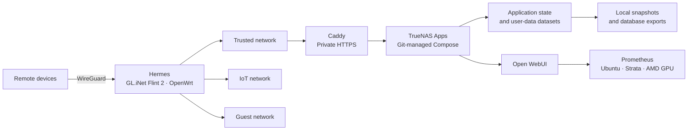

# Homelab

I run my personal cloud on a repurposed gaming PC with [TrueNAS](https://www.truenas.com/truenas-community-edition/). It holds my photos, files, notes, passwords, and media. A second machine, Prometheus, runs local AI models on an AMD GPU.

I started this to replace recurring subscriptions and have more control over my data. This repository records the setup, the decisions behind it, and the things I still need to improve.

The pages below cover the current setup, routine operations, and the migrations that shaped it. Configuration files stay alongside their applications; runtime data and secrets live outside the repository.

## Architecture

Hermes is the main router, with working trusted, IoT, and guest networks. WireGuard on Hermes provides remote access. The eero is retired. Local services use `home.arpa` names and Caddy HTTPS; Immich, Bitwarden, and DAVx5 work on my phone through those URLs. The diagram shows relationships, not individual switch ports or firewall rules. See [infrastructure](docs/infrastructure.md) for hardware and storage details.

## Hardware gallery

Click a photo to view it larger.

<table>
  <tr>
    <td width="33%" valign="top">
       
      Gaming PC before TrueNAS, GPU removal, and storage upgrades.
    </td>
    <td width="33%" valign="top">
       
      Two 6 TB WD Red Plus drives for the mirrored pool.
    </td>
    <td width="33%" valign="top">
       
      Case disassembled during the conversion.
    </td>
  </tr>
</table>

## What I run

| Area | Services and workflows |
| --- | --- |
| Personal data | [Nextcloud](https://nextcloud.com/) for files, calendar, contacts, and bookmarks; [Immich](https://immich.app/) for automatic photo and video uploads; [Vaultwarden](https://github.com/dani-garcia/vaultwarden) for passwords |
| Notes and budgeting | [Joplin](https://github.com/laurent22/joplin) Markdown notes synced through Joplin Server; [Actual Budget](https://actualbudget.org/) with SimpleFIN transaction imports |
| Media | [Jellyfin](https://jellyfin.org/) for movies and TV, [Audiobookshelf](https://audiobookshelf.org/) for purchased audiobooks, [Navidrome](https://www.navidrome.org/) for music |
| Personal projects | [Crafty 4](https://craftycontrol.com/) for a Minecraft server; [LubeLogger](https://lubelogger.com/) for truck maintenance, modifications, and fuel |
| Local AI | Strata on Prometheus, accessed through [Open WebUI](https://github.com/open-webui/open-webui) on TrueNAS |
| Supporting infrastructure | Caddy for private HTTPS, code-server for editing, SearXNG for search, and qBittorrent with Gluetun/PIA for downloads |

I use a mix of web interfaces and dedicated apps, including [DAVx5](https://github.com/bitfireAT/davx5-ose) and [floccus](https://github.com/floccusaddon/floccus) with Nextcloud, [Navic](https://github.com/ssalggnikool/Navic) with Navidrome, and [AFinity](https://github.com/MakD/AFinity) with Jellyfin. I also built [LubeLogger-Android](https://github.com/AldogPlays/LubeLogger-Android), which I use with my own server.

## Why it's set up this way

- **Reuse existing hardware:** upgraded the former gaming PC's memory and storage, added a 2.5 GbE NIC, and removed its discrete GPU.
- **Separate storage roles:** a dedicated SSD boots TrueNAS; two 6 TB HDDs form a mirrored data pool.
- **Keep deployments understandable:** TrueNAS manages app lifecycle while Compose definitions live in Git, separate from runtime state and secrets.
- **Make it useful every day:** the lab replaces Google Photos, YouTube Music, Audible, and other services I used to rely on.

See [decisions and lessons](docs/decisions-and-lessons.md) for the reasoning and tradeoffs.

## Limitations and next steps

Local ZFS snapshots and daily PostgreSQL backup/retention jobs were newly configured on November 4. A manual backup run succeeded. Email alerts, an offsite copy, and a full restore test are still outstanding; scheduled execution is the next check for the new jobs. See [backups and snapshots](docs/backups.md) for coverage and limits.

The [roadmap](docs/roadmap.md) covers recovery verification, network follow-ups, and a future *Arr stack; none is deployed yet. Prometheus starts successfully after reboot. Its completed [standard Q2_0 benchmark](docs/local-ai.md#q2_0-standard-benchmark) passed all 12 sanity checks with no failed requests; median decode rates were 36.5–49.7 tokens/s across short, 4K, and 16K cases. The report preserves output-cap and latency limits alongside those results.

## Subscription costs avoided

These are the subscriptions I've replaced. The estimate uses U.S. monthly prices checked October 12, 2026, with assumed tiers rather than my old bills.

| Subscription dropped | Assumed plan | Monthly | Annualized |
| --- | --- | ---: | ---: |
| Google One | 100 GB | $1.99 | $23.88 |
| YouTube Music Premium | Individual | $11.99 | $143.88 |
| Netflix | Standard with ads | $8.99 | $107.88 |
| Disney+ | With ads, new-subscriber rate | $12.49 | $149.88 |
| **Estimated spending avoided** | | **$35.46** | **$425.52** |

The annual figures are 12 monthly payments. These are avoided subscription costs, before tax, discounts, and the cost of running the lab. PIA and SimpleFIN are still part of my setup. My own media library also differs from a streaming service's catalog.

## Repository configuration

Compose source files live in `<app>/compose.yaml`, under `/workspace` in code-server and `/mnt/tank/stacks` on the host. The repository has 15 stack directories, plus shared documentation, maintenance scripts, and hardware photos. TrueNAS Apps loads the on-disk Compose files; their presence does not verify the running deployment.

Runtime state and secrets belong in `/mnt/tank/appdata`, user data in `/mnt/tank/data`, and local backup archives in `/mnt/tank/backups`. These contents stay outside Git. Compose configurations include internal addresses and service mappings. See [services](docs/services.md) for source references and [operations](docs/operations.md) for the deployment workflow.

## Documentation

| Document | What it covers |
| --- | --- |
| [Infrastructure](docs/infrastructure.md) | Hardware, dataset layout, permissions, and networking |
| [Services and clients](docs/services.md) | Service purposes, deployment, Android clients, and integrations |
| [Local AI](docs/local-ai.md) | Local model setup notes and benchmark results |
| [Decisions and lessons](docs/decisions-and-lessons.md) | Motivations, tradeoffs, and practical lessons |
| [Migration history](docs/migrations.md) | The storage and application refactor, outcomes, and verification |
| [Operations and troubleshooting](docs/operations.md) | Deployment workflow, shell contexts, and troubleshooting |
| [Backups and snapshots](docs/backups.md) | Protection policies, schedules, and recovery checks |
| [PostgreSQL recovery](docs/POSTGRES_RECOVERY.md) | Integrity checks and a manual database recovery procedure |
| [Roadmap](docs/roadmap.md) | Planned improvements and unresolved details |

Public diagrams show the layout without private addresses or service mappings.
