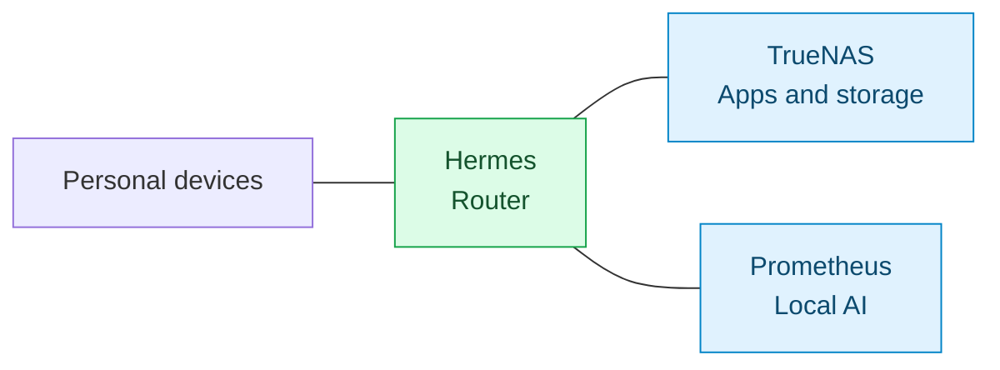
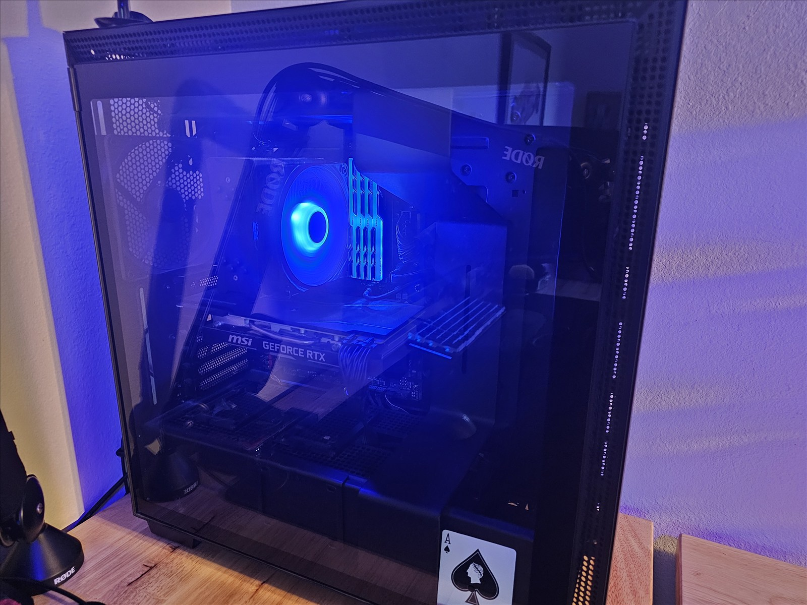
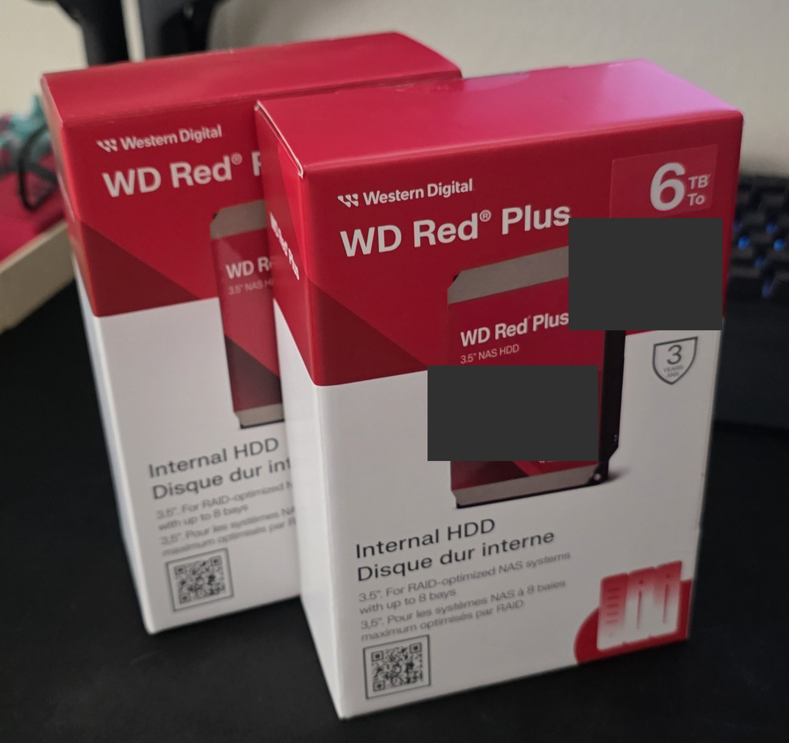
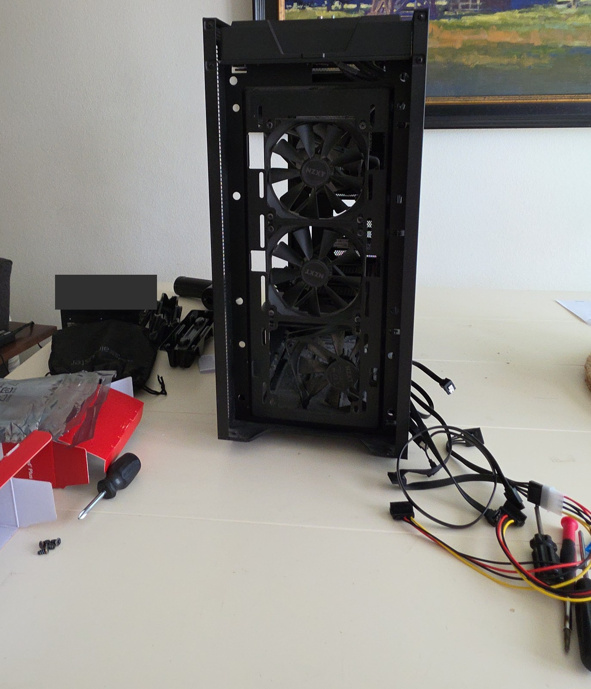

# Homelab

**On this page:** [Architecture](#architecture) · [Services](#what-i-run) · [Documentation](#documentation) · [Status](#current-status) · [Photos](#hardware-gallery)

I run my personal cloud on a repurposed gaming PC with [TrueNAS](https://www.truenas.com/truenas-community-edition/). It holds my photos, files, notes, passwords, and media. A second machine, Prometheus, runs local AI models on an AMD GPU.

I started this to replace recurring subscriptions and have more control over my data. This repository documents what I've built, how it works, and how I maintain it. Application configurations live alongside the documentation; runtime data and credentials stay outside Git.

## Architecture

Hermes connects the lab, TrueNAS hosts applications and data, and Prometheus runs local AI. The [networking guide](docs/setup/networking.md) explains network separation and local/remote access.

## What I run

| Area | Services |
| --- | --- |
| Personal cloud | Nextcloud for files, calendar, contacts, and bookmarks; Immich for photos and videos; Vaultwarden for passwords |
| Notes and budgeting | Joplin Server for notes synchronization; Actual Budget with SimpleFIN imports |
| Media | Jellyfin for movies and TV; Audiobookshelf for purchased audiobooks; Navidrome for music |
| Personal projects | Crafty 4 for Minecraft; LubeLogger for truck maintenance, modifications, and fuel |
| Local AI | Open WebUI on TrueNAS, connected to Strata on Prometheus |
| Supporting services | Caddy, code-server, SearXNG, and qBittorrent with Gluetun/PIA |

The [service guide](docs/setup/services.md) covers dependencies, clients, and links to all 15 Compose stacks. The [decisions and lessons](docs/history/decisions-and-lessons.md) explain the hardware reuse, storage design, and subscriptions this setup replaces.

## Documentation

The [documentation index](docs/README.md) brings together the setup guides, maintenance procedures, recovery instructions, and history.

| I need to… | Start here |
| --- | --- |
| Understand the lab | [Infrastructure](docs/setup/infrastructure.md) → [Networking](docs/setup/networking.md) → [Services](docs/setup/services.md) |
| Use or maintain local AI | [Local AI](docs/setup/local-ai.md) and the [Q2_0 benchmark](docs/benchmarks/q2-0.md), with timing definitions before the results |
| Maintain or troubleshoot a service | [Operations](docs/operations/README.md) and [Troubleshooting](docs/operations/troubleshooting.md) |
| Recover application data | [Backups](docs/operations/backups.md) → [PostgreSQL recovery](docs/operations/postgres-recovery.md) |
| Understand past choices or remaining work | [Decisions and lessons](docs/history/decisions-and-lessons.md), [Migration history](docs/history/migrations.md), and [Roadmap](docs/roadmap.md) |

## Current status

This status reflects the work recorded through November 4, 2026 Pacific time (November 5 UTC).

| Status | Work |
| --- | --- |
| **Working** | Storage migration, three-network setup, phone HTTPS access, and Prometheus startup after reboot |
| **Measured** | Standard Q2_0 benchmark complete |
| **Configured; partly verified** | Local snapshots and daily PostgreSQL jobs, configured November 4, 2026; initial snapshots and a manual backup succeeded |
| **Follow-ups** | Unattended execution, a full restore test, email alerts, and an offsite copy |
| **Planned** | Media automation with an *Arr stack |

## Hardware gallery

Click a photo to view it larger.

<table>
  <tr>
    <td width="33%" valign="top">
       
      <strong>The starting point</strong> 
      Gaming PC before the TrueNAS conversion.
    </td>
    <td width="33%" valign="top">
       
      <strong>Mirrored storage</strong> 
      Two 6 TB WD Red Plus data drives.
    </td>
    <td width="33%" valign="top">
       
      <strong>The conversion</strong> 
      Case disassembled for the upgrades.
    </td>
  </tr>
</table>
