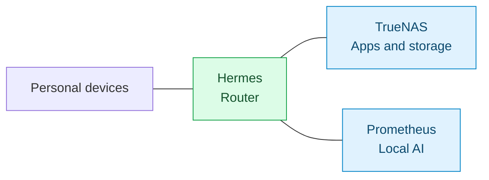

# Homelab

I run my personal cloud on a repurposed gaming PC with [TrueNAS](https://www.truenas.com/truenas-community-edition/). It holds my photos, files, notes, passwords, and media. A second machine, Prometheus, runs local AI models on an AMD GPU.

I started this to replace recurring subscriptions and have more control over my data. These are my notes on what I run, how it works, and what I learned setting it up. The app configurations are here too; my data and credentials stay outside Git.

## Architecture

Hermes connects the lab, TrueNAS hosts applications and data, and Prometheus runs local AI. The [networking guide](docs/networking.md) explains network separation and local/remote access.

## What I run

| Area | Services |
| --- | --- |
| Personal cloud | Nextcloud for files, calendar, contacts, and bookmarks; Immich for photos and videos; Vaultwarden for passwords |
| Notes and budgeting | Joplin Server for notes synchronization; Actual Budget with SimpleFIN imports |
| Media | Jellyfin for movies and TV; Audiobookshelf for purchased audiobooks; Navidrome for music |
| Personal projects | Crafty 4 for Minecraft; LubeLogger for truck maintenance, modifications, and fuel |
| Local AI | Open WebUI on TrueNAS, connected to Strata on Prometheus |
| Supporting services | Caddy, code-server, SearXNG, and qBittorrent with Gluetun/PIA |

The [service guide](docs/services.md) covers dependencies, clients, and links to all 15 Compose stacks. The [decisions and lessons](docs/decisions-and-lessons.md) explain the hardware reuse, storage design, and subscriptions this setup replaces.

## Documentation

My notes cover the setup, maintenance, benchmarks, and the changes I made along the way.

- Setup: [Infrastructure](docs/infrastructure.md), [networking](docs/networking.md), [services](docs/services.md), and [local AI](docs/local-ai.md).
- Maintenance: [Operations](docs/operations.md), [troubleshooting](docs/troubleshooting.md), [backups](docs/backups.md), and [database recovery](docs/postgres-recovery.md).
- Benchmarks: [Comparisons and tuning](docs/benchmarks.md), plus my [original Q2_0 run](docs/q2-benchmark.md).
- Background: [Decisions and lessons](docs/decisions-and-lessons.md) and [migration history](docs/migrations.md).

## Hardware gallery

Click a photo to view it larger.

<table>
  <tr>
    <td width="33%" valign="top">
       
      <strong>The starting point</strong> 
      Gaming PC before the TrueNAS conversion.
    </td>
    <td width="33%" valign="top">
       
      <strong>Mirrored storage</strong> 
      Two 6 TB WD Red Plus data drives.
    </td>
    <td width="33%" valign="top">
       
      <strong>The conversion</strong> 
      Case disassembled for the upgrades.
    </td>
  </tr>
</table>
