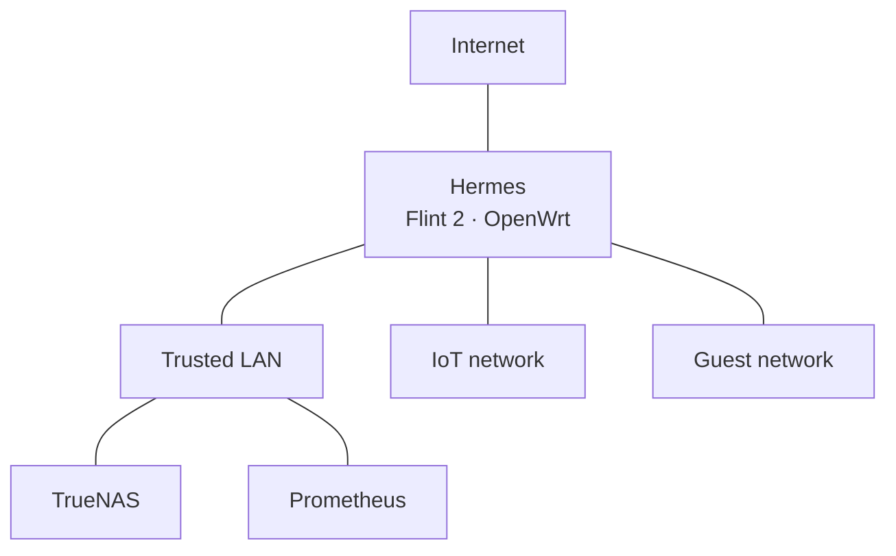

# Infrastructure

[Overview](../README.md) · [Services](services.md) · [Local AI](local-ai.md) · [Backups](backups.md) · [Migration history](migrations.md)

The lab has a TrueNAS application/storage host, a separate Ubuntu AI host, and Hermes, a GL.iNet Flint 2 running OpenWrt as the main router.

## TrueNAS application and storage host

My former NZXT BLD gaming PC runs TrueNAS Community Edition. The last documented OS release is TrueNAS SCALE 25.10.4.

| Component | Hardware |
| --- | --- |
| CPU | Intel Core i7-9700K, 8 cores, 3.6 GHz base |
| Motherboard | Gigabyte Z390 AORUS PRO WIFI |
| Memory | 32 GB G.SKILL TridentZ RGB DDR4-3200, four 8 GB sticks |
| Boot drive | Intel 665p 1 TB SSD |
| Data drives | Two WD Red Plus 6 TB HDDs in mirrored pool `tank` |
| Added network adapter | Realtek 2.5 GbE NIC; exact model unspecified |
| Case | NZXT H710, black |
| CPU cooler | Deepcool GAMMAX GTE V2 |
| Additional fans | Two NZXT Aer F 120 fans |
| Power supply | be quiet! Pure Power 11 700W CM Gold |
| Accessory | NZXT USB Expansion |

The conversion replaced the original Seagate Barracuda 2 TB HDD, expanded memory from 16 to 32 GB, added the network adapter, and removed the MSI GeForce RTX 2070 SUPER VENTUS OC. I also cleaned the system and repositioned the drive tray for the new disks.

TrueNAS Apps manages the application lifecycle. On-disk Compose files are loaded through **Install via YAML**, keeping deployment definitions in Git. See [operations](operations.md#deployment-workflow) for the include pattern and execution contexts.

## Storage layout

The tree distinguishes ZFS datasets from ordinary directories. `<app>` represents each application's directory or dataset.

```text
tank/                         ZFS pool/root dataset
├── stacks/                   ZFS dataset; this Git repository
│   ├── <app>/                ordinary directory; Compose source
│   ├── docs/                 ordinary directory; documentation
│   └── scripts/              ordinary directory; maintenance script sources
├── appdata/                  ZFS dataset
│   └── <app>/                per-app ZFS dataset; runtime state and secrets
├── data/                     ZFS dataset
│   ├── files/                ZFS dataset; Nextcloud user files
│   ├── photos/               ZFS dataset; Immich photo/video data
│   ├── games/                ZFS dataset; reserved user-data location
│   └── media/                ZFS dataset
│       ├── audiobooks/       ordinary directory
│       ├── music/            ordinary directory
│       └── torrents/         ordinary directory
└── backups/                  ZFS dataset
    ├── databases/            ZFS dataset; per-app backup directories within it
    └── bin/                  ordinary directory; protected operational scripts
```

The pool is mounted beneath `/mnt/tank`. The repository appears at `/workspace` inside code-server. Runtime state, databases, secrets, and user data stay outside Git. Compose references to these paths document the deployment without including their contents.

The legacy `tank/Apps` dataset was deleted after dependency checks and application cutovers on November 3. Audiobookshelf deliberately retains an old-looking **container destination** beneath `/mnt/tank/Apps`; its **host source** is the new shared media directory. Crafty's migrated server files live in `appdata/crafty-4/servers`, rather than in the otherwise reserved `data/games` dataset.

Media directories share one ZFS filesystem to support the planned downloader/library hardlink workflow. Future movie, TV, and automation paths are plans until configured and checked; the existing qBittorrent source mounts only `media/torrents` at `/data/torrents`. See [services](services.md#media-storage) before designing additional mounts.

## Permissions and recovery

Code-server uses editor UID `3000`, GID `3001`. Application identities vary: several use `568:568`, PostgreSQL uses `999:999`, Crafty uses `1000:1000`, and Joplin Server uses `1001:1001`. Supplementary groups and dataset ACLs also affect access. App data was handled per service, without recursively changing the entire storage tree.

The mirror protects against a single data-drive failure. Periodic snapshots and PostgreSQL logical backups for five applications were added on November 4, 2026. The [backup reference](backups.md) covers exclusions, schedules, and verification; [PostgreSQL recovery](POSTGRES_RECOVERY.md) describes selecting and restoring an archive. Email alerts, an offsite copy, and a full restore test are not yet in place.

## Prometheus AI host

| Component | Configuration |
| --- | --- |
| Host / OS | `prometheus`, Ubuntu Server 26.04.1 LTS |
| CPU | AMD Ryzen 7 7800X3D, 8 cores / 16 threads after BIOS troubleshooting |
| Motherboard / BIOS | Gigabyte B650I AORUS ULTRA / F43c |
| GPU | PowerColor Radeon RX 7800 XT, 16 GiB VRAM; AMD integrated graphics also present |
| RAM / swap | 32 GB DDR5, about 29 GiB reported usable; 8 GiB swap |
| Storage | Approximately 2 TB NVMe; 100 GB root LV and 1 TB ext4 AI-data LV |
| AI storage mount | `/srv/ai`, on `/dev/ubuntu-vg/ai-data`; mount persistence observed after reboots |
| Ethernet | Intel I225-V, `igc`, `enp13s0`, negotiated 2.5 Gb/s full duplex |

Strata runs in Docker with AMD device access. Open WebUI runs on TrueNAS and connects to Strata across the LAN. Prometheus serves Q2_0 with 64K context, prefers Ethernet with Wi-Fi fallback, and starts successfully after reboot. [Local AI](local-ai.md) covers paths, serving settings, startup reliability, and benchmark results.

## Networking and access



This shows logical network membership. Physical port assignments and inter-network firewall rules remain to be documented. For local and remote HTTPS connections, see the [service access flow](services.md#caddy-dns-and-trust).

| Item | Configuration |
| --- | --- |
| Internet | 2 Gb/s fiber |
| Hermes | GL.iNet Flint 2, main OpenWrt router/gateway at `10.10.10.1`; version 25.12.6 recorded during setup |
| Trusted LAN | `10.10.10.0/24` |
| IoT network | `10.10.20.0/24`; configured and working |
| Guest network | `10.10.30.0/24`; configured and working |
| TrueNAS | `10.10.10.10` |
| Prometheus | Ethernet DHCP reservation `10.10.10.20`; preferred route metric 100 |
| Prometheus fallback | Wi-Fi online with route metric 600; dynamic address |
| Switch | TP-Link unmanaged eight-port 2.5 GbE switch |
| Local DNS | Service names under `home.arpa`, managed in Hermes during HTTPS setup |
| Private HTTPS | Caddy on TrueNAS, using its internal CA; routes are in the repository Caddyfile |
| Remote access | WireGuard on Hermes |

All three networks are configured and working. The eero is retired, so its former 1 Gb/s uplink bottleneck no longer describes this setup. Physical port assignments, detailed firewall rules, and end-to-end throughput remain documentation follow-ups.

Tailscale, AdGuard Home, File Browser, Jackett, and FlareSolverr are retired. WireGuard provides remote access, while Gluetun/PIA handles qBittorrent's outbound VPN traffic. Immich, Bitwarden, and DAVx5 work through the private HTTPS URLs on my phone.
