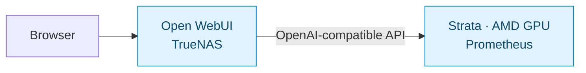

# Local AI

> [Overview](../README.md) · [Infrastructure](infrastructure.md) · [Networking](networking.md) · [Services](services.md) · [Operations](operations.md)

The local AI setup has two parts: **Open WebUI** on TrueNAS provides the browser interface, and **Strata** on Prometheus runs the model and generates responses using the AMD GPU. The current model is `qwen3.8-flash-next-q2_0`, configured with a 65,536-token (64K) context window. Startup after reboot has been verified.

**On this page:** [Serving layout](#serving-layout) · [Benchmark](#q2_0-standard-benchmark) · [Timing definitions](#how-to-read-the-timings) · [Run command](#run-command) · [Runtime and maintenance](#runtime-and-maintenance)

## Serving layout



Open WebUI connects to Strata through `/v1/models` and `/v1/chat/completions`. The [WebUI stack](../open-webui/compose.yaml) persists its backend data, disables Ollama integration, and is served through Caddy. [Networking](networking.md) covers client access and Ethernet/Wi-Fi routing; [infrastructure](infrastructure.md#prometheus-ai-host) records the hardware.

Here, “OpenAI-compatible” describes the API format used between the two services. Strata performs the inference on Prometheus. `/v1/models` lists available models, and `/v1/chat/completions` accepts chat requests.

Three settings describe different parts of this setup:

| Term | Meaning here |
| --- | --- |
| Q2_0 | The quantization label for the model being served. Quantization stores model weights at reduced precision; this run does not compare its quality with other quantizations. |
| 64K context | The configured token window for a request. Tokens are chunks of text, so 65,536 tokens is not a word count. A configured window does not establish how well the model uses all of it. |
| Thinking enabled | The model generates reasoning as well as visible answer text. That reasoning consumes generated tokens and time before or alongside the answer. |

## Q2_0 standard benchmark

This is the setup's single recorded performance baseline. It ran on November 4, 2026 Pacific time (November 5 UTC), directly against Strata's API inside the container. It measures the backend, excluding Open WebUI and the browser connection.

The main results are:

- **Reliability in this run:** zero failed requests and 12/12 sanity checks passed.
- **Generation speed:** median rates of 36.5–49.7 tokens/s.
- **Initial wait:** the median time to the first token grew from 1.41 seconds on the short prompt to 78.66 seconds on the 16K prompt.

Generation speed alone therefore does not describe how responsive a long-prompt request feels.

Each performance request had a **512-token output cap shared by reasoning and answer text**. Seven of the nine performance requests reached it; one 16K request produced no visible answer before stopping. These are useful timing results, but zero failures does not mean every request delivered a complete answer. The [sanity checks](#output-caps-and-sanity-checks) are separate, limited checks of instruction following, retrieval, and tool calls.

### How to read the timings

For a request, the server first processes the input prompt and then generates output tokens. With thinking enabled, the first generated token may be reasoning; the first visible answer can arrive later.

| Metric | What it tells you |
| --- | --- |
| Prompt tokens/s | How quickly the input is processed. Higher is faster, but a longer prompt can still take more time overall. |
| Decode tokens/s | How quickly output tokens are generated, including reasoning. This is not a rate for visible answer text alone. |
| First token, s | Time from the request to the first generated token, which may be reasoning. Lower is faster. |
| First answer, s | Time from the request to the first visible answer text. It is unavailable if no answer appears before the output cap. |
| Total, s | Time until the request stops, either by finishing or by reaching its output cap. |
| Capped | Number of requests that reached the output cap, out of the samples in that row. |

The short input was about 80 tokens; the larger cases used approximately 4K and 16K prompt tokens. Each performance case ran three times. A median is the middle of the measured values; the ranges below show the smallest and largest values.

These small sample counts describe this run, not a guaranteed response time.

### Performance

| Case | Prompt tokens/s | Decode tokens/s | First token, s |
| --- | ---: | ---: | ---: |
| Short | Not reported | 49.7 | 1.41 |
| 4K prompt | 167.3 | 36.5 | 24.50 |
| 16K prompt | 208.5 | 44.5 | 78.66 |

Values are medians from three repetitions. For example, the 16K case took a median 78.66 seconds to produce its first token, even though its median generation rate after that was 44.5 tokens/s. The API was accessed through container loopback (`127.0.0.1`), so these measurements exclude Open WebUI overhead.

### Full timing results

Values are medians with minimum–maximum ranges. Each metric has three samples per case, **except 16K first-answer latency, which has only two**: the third request reached the cap without visible answer text.

That missing sample explains why the 16K first-answer median below is smaller than its first-token median. They summarize different sets of requests; they do not show an answer arriving before its own first token. Do not subtract these medians to calculate reasoning time.

| Metric | Short | 4K prompt | 16K prompt |
| --- | ---: | ---: | ---: |
| Prompt tokens/s | Not reported | 167.3 (121.4–215.6) | 208.5 (158.9–322.2) |
| Decode tokens/s | 49.7 (39.4–64.0) | 36.5 (30.9–53.2) | 44.5 (29.3–49.6) |
| First token, s | 1.41 (0.85–1.52) | 24.50 (19.01–33.77) | 78.66 (50.92–103.23) |
| First answer, s | 2.89 (2.81–9.33) | 29.09 (25.43–46.69) | 70.16 (58.38–81.94) |
| Total, s | 11.1 (8.0–13.4) | 34.1 (33.0–50.3) | 96.1 (62.4–113.5) |
| Capped | 1/3 | 3/3 | 3/3 |

The report omits the short case's prompt-processing rate because fixed request overhead dominates at about 80 input tokens.

<details>
<summary><strong>Run configuration and provenance</strong></summary>

| Item | Benchmark configuration |
| --- | --- |
| Started | 2026-11-05 05:44:24 UTC; November 4, 21:44:24 Pacific |
| Run ID | `20261105T054424Z-1e39bba3` |
| Protocol | `strata-qwen38-thinking-v1-draft.1`, draft; `standard-v1` suite |
| Strata commit | `c62d5e3a15b40ea51c96aae9e8d36928965f53ab` |
| Engine / build | 0.1.55 / release |
| Model / quantization | `qwen3.8-flash-next-q2_0` / Q2_0 |
| Context / capacity | 65,536 tokens / one serving slot |
| Track | `custom`; no additional track notes |
| Sampling | Temperature 1.0; top_p 0.95; top_k 20; min_p 0; presence penalty 0; repetition penalty 1.0 |
| Reasoning | `xhigh`, thinking enabled and preserved |
| Duration after model loading | 20 minutes 42 seconds, as reported by the runner |
| Host | Ryzen 7 7800X3D, RX 7800 XT 16 GiB from the host inventory; runner reported generic `AMD Radeon` and 30.0 GiB RAM |
| Host OS | Ubuntu 26.04.1 LTS, from host `/etc/os-release` |
| Runner environment | Inside Docker: Ubuntu 24.04.5 LTS; kernel `7.0.0-42-generic` |

These values identify the measured run, including its draft protocol and exact Strata commit. They should accompany comparisons with any future run.

The two Ubuntu versions refer to different layers: Prometheus runs Ubuntu 26.04.1, while the benchmark container contains Ubuntu 24.04.5 userspace tools and libraries. The runner reads the container's `/etc/os-release`; see the [OS-probe source](https://github.com/Niko1221/Strata/blob/main/strata_cli/bench_facts.py).

</details>

### Output caps and sanity checks

The runner labels a request that reaches its output cap `truncated`. This is an expected benchmark boundary, distinct from a failed request. For performance requests, the cap was **512 tokens, including reasoning and visible answer text**; total duration for a capped request measures time to that cap, not time to a complete answer. This test setting neither reduces the configured 64K context nor establishes the model's maximum output length. See the [protocol's truncation rules](https://github.com/Niko1221/Strata/blob/main/docs/BENCHMARK_PROTOCOL.md).

| Phase | Planned | Completed without cap | Truncated | Failed | Skipped |
| --- | ---: | ---: | ---: | ---: | ---: |
| Warm-up | 1 | 0 | 1 | 0 | 0 |
| Performance | 9 | 2 | 7 | 0 | 0 |
| Sanity | 12 | 12 | 0 | 0 | 0 |
| Concurrency | 0 | 0 | 0 | 0 | 0 |

All four instruction checks, four retrieval checks, and four tool-call checks passed. This verifies those twelve specific test cases; it is not a broad intelligence or coding-quality score.

The test coverage has two further limits:

- **Simultaneous requests:** no concurrency test was run.
- **Full context window:** the longest performance input was approximately 16K; the full 64K allocation was not exercised.

### Artifacts and limits

The original files remain on Prometheus, outside this repository:

```text
/srv/ai/strata/data/benchmarks/q2_0-20261105T054344Z/
├── README.md
├── config.json
├── outputs.jsonl
├── provenance/
└── results.json
```

The tables above summarize the generated benchmark README. Full request traces, configuration, and provenance remain in the artifact directory. The report files are root-owned, mode `600`; read them with `sudo` rather than changing their permissions.

**Model identification.** The model was stored across two GGUF files, a format used for model weights. The report records abbreviated hash prefixes `69820c02ec7d0b45…` and `316b46f3a2dbd68c…`; complete hashes belong to the original artifacts. Model/source revisions, driver/runtime versions, storage characteristics, and background work were not measured.

**Cache state.** The server had answered one request before the run. Shared template-prefix and expert-cache state remained warm and evolved during the test: some reusable prompt and model data was already cached. The timings therefore do not describe a model's first request from a cold start.

**Repeating the test.** Reaching the output cap does not invalidate this baseline. If repeating the fixed suite, restart the engine between runs as required by the protocol to avoid reusing prompt state.

### Run command

Run this on **Prometheus** when intentionally starting a benchmark; it sends inference requests and writes report files. Leave other inference clients idle. For a repeat of the fixed suite, first restart the engine as required by the protocol, then wait for the model to be ready.

The command below uses the already-running engine and does not perform that restart:

```bash
sudo docker exec -it strata sh -ec '
  strata bench run --help >/dev/null
  export STRATA_API_KEY="$(cat /run/secrets/strata_api_key)"
  exec strata bench run \
    --url http://127.0.0.1:8080 \
    --no-start \
    --out "/data/benchmarks/q2_0-$(date -u +%Y%m%dT%H%M%SZ)"
'
```

This uses the running model through container loopback, reads authentication from its existing mounted file, and saves reports in persistent storage. `--no-start` prevents the runner from launching another engine. The help check stops the block if the installed CLI lacks the benchmark command. Command behavior and authentication are documented in [terminal commands](https://github.com/Niko1221/Strata/blob/main/docs/TERMINAL.md).

The output directory inside the container maps to `/srv/ai/strata/data/benchmarks/` on Prometheus. Retain the generated README, JSON, and supporting files together. Review the report before publishing. The reported 20 minutes 42 seconds applies to this run after model loading; it is not a universal duration estimate.

## Runtime and maintenance

These are recorded setup values; check the running versions after updates. The Strata image uses a moving tag. Its full Compose definition is managed on Prometheus, outside this repository.

| Item | Configuration |
| --- | --- |
| Host OS / kernel | Ubuntu Server 26.04.1 LTS / `7.0.0-42-generic` |
| Docker / Compose | Docker CE 29.9.2 / Compose 5.7.0 at installation |
| Strata image / engine | `ghcr.io/niko1221/strata:latest-rocm-gfx110x` / engine 0.1.55 HIP in logs |
| Model / context | `qwen3.8-flash-next-q2_0` / 65,536 tokens |
| Capabilities | Text-only; vision disabled; Bearer API authentication |
| OpenAI-compatible base URL | `http://10.10.10.20:8080/v1` |

### Storage and configuration

| Prometheus path | Role |
| --- | --- |
| `/srv/ai/strata/compose.yaml` | Host-side deployment definition |
| `/srv/ai/strata/data` | Models, packed experts, draft layers, and runtime state; mounted at `/data` |
| `/etc/systemd/system/strata-compose.service` | Host-managed Compose startup unit |

The dedicated logical volume (LV), formatted with ext4, is mounted persistently at `/srv/ai`; the remaining volume-group space was left unallocated.

Engine logs are at `/data/state/strata/launch/docker.engine.log` inside the container. Authentication is supplied through an existing protected mount referenced by the host-side configuration; keep its contents out of logs and documentation.

The recorded container settings are:

| Area | Settings |
| --- | --- |
| Model selection | `FAMILY: qwen`, `MODEL: Q2_0` |
| Context and input | `CONTEXT: "64k"`, `VISION: "off"` |
| Authentication | `API_KEY_FILE` references the mounted credential file |
| AMD GPU access | `/dev/kfd`, `/dev/dri`, and video/render groups `44` and `991` |
| Memory | 2 GB shared memory; unlimited memlock |
| Shutdown and logs | 120-second stop grace period; bounded JSON-file logs |
| API publication | Ethernet address, TCP 8080 |

The 64K setting allocates context space. The standard suite's longest performance prompt was approximately 16K, so this benchmark does not establish full-window answer quality.

### Startup and diagnostics

The systemd unit waits for the reserved Ethernet address on `enp13s0`, then invokes Compose with `up -d --force-recreate`. Both manual startup and startup after reboot have succeeded.

Hardware power-outage recovery and recovery from an unhealthy-but-running process still need separate verification.

For a healthy model with an unreachable host API, use [Prometheus diagnostics](operations.md#prometheus-healthy-container-unreachable-api). For responses that appear late in the browser, compare backend completion with [Open WebUI timing](operations.md#open-webui-replies-appear-late).

The earlier Windows-to-Ubuntu move, SMT fix, and Netplan changes are recorded in [migration history](migrations.md#prometheus-move-to-ubuntu).
