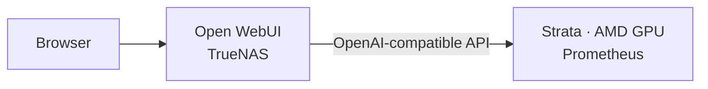

# Local AI

[Overview](../README.md) · [Infrastructure](infrastructure.md) · [Networking](networking.md) · [Services](services.md) · [Operations](operations.md)

Prometheus runs Strata inference on a dedicated AMD GPU machine. Open WebUI on TrueNAS provides the browser interface. The working configuration serves Q2_0 with 64K context and starts successfully after reboot.

Jump to the [benchmark](#q2_0-standard-benchmark), [repeat-run command](#run-command), or [runtime and maintenance](#runtime-and-maintenance).

## Serving layout



Open WebUI connects to Strata through `/v1/models` and `/v1/chat/completions`. The [WebUI stack](../open-webui/compose.yaml) persists its backend data, disables Ollama integration, and is served through Caddy. [Networking](networking.md) covers client access and Ethernet/Wi-Fi routing; [infrastructure](infrastructure.md#prometheus-ai-host) records the hardware.

## Q2_0 standard benchmark

The standard Q2_0 run completed with **zero failed requests** and **12/12 sanity checks passed**. This is the single performance baseline for the setup. It ran on November 4, 2026 Pacific time (November 5 UTC), with a 512-token output cap per performance request.

### Performance

| Case | Prompt tokens/s | Decode tokens/s | First token, s |
| --- | ---: | ---: | ---: |
| Short | Not reported | 49.7 | 1.41 |
| 4K prompt | 167.3 | 36.5 | 24.50 |
| 16K prompt | 208.5 | 44.5 | 78.66 |

Values are medians from three repetitions. Median decode rates ranged from 36.5 to 49.7 tokens/s, while longer prompts incurred substantial startup latency. These loopback API measurements include reasoning and exclude Open WebUI overhead.

<details>
<summary>Full timing results, ranges, and sample counts</summary>

Values are medians with minimum–maximum ranges. Each performance case has three samples, except 16K first-answer latency, which has two.

| Case | Prompt tokens/s | Decode tokens/s | First token, s | First answer, s | Total, s | Capped |
| --- | --- | --- | --- | --- | --- | --- |
| Short | Not reported | 49.7 (39.4–64.0) | 1.41 (0.85–1.52) | 2.89 (2.81–9.33) | 11.1 (8.0–13.4) | 1/3 |
| 4K prompt | 167.3 (121.4–215.6) | 36.5 (30.9–53.2) | 24.50 (19.01–33.77) | 29.09 (25.43–46.69) | 34.1 (33.0–50.3) | 3/3 |
| 16K prompt | 208.5 (158.9–322.2) | 44.5 (29.3–49.6) | 78.66 (50.92–103.23) | 70.16 (58.38–81.94) | 96.1 (62.4–113.5) | 3/3 |

The short prompt was about 80 tokens, so the report omits its prompt-processing rate because fixed request overhead dominates. The 16K first-answer median uses a different sample count from its first-token median: one request produced no visible answer before the cap. The two medians therefore are not a paired timing comparison.

</details>

<details>
<summary>Run configuration and provenance</summary>

| Item | Benchmark configuration |
| --- | --- |
| Started | 2026-11-05 05:44:24 UTC; November 4, 21:44:24 Pacific |
| Run ID | `20261105T054424Z-1e39bba3` |
| Protocol | `strata-qwen38-thinking-v1-draft.1`, draft; `standard-v1` suite |
| Strata commit | `c62d5e3a15b40ea51c96aae9e8d36928965f53ab` |
| Engine / build | 0.1.55 / release |
| Model / quantization | `qwen3.8-flash-next-q2_0` / Q2_0 |
| Context / capacity | 65,536 tokens / one serving slot |
| Track | `custom`; no additional track notes |
| Sampling | Temperature 1.0; top_p 0.95; top_k 20; min_p 0; presence penalty 0; repetition penalty 1.0 |
| Reasoning | `xhigh`, thinking enabled and preserved |
| Duration after model loading | 20 minutes 42 seconds, as reported by the runner |
| Host | Ryzen 7 7800X3D, RX 7800 XT 16 GiB from the host inventory; runner reported generic `AMD Radeon` and 30.0 GiB RAM |
| Host OS | Ubuntu 26.04.1 LTS, from host `/etc/os-release` |
| Runner environment | Inside Docker: Ubuntu 24.04.5 LTS; kernel `7.0.0-42-generic` |

The benchmark ran inside Docker, so its Ubuntu 24.04.5 label describes the container userspace. The Prometheus host runs Ubuntu 26.04.1. The runner reads its local `/etc/os-release`; see the [OS-probe source](https://github.com/Niko1221/Strata/blob/main/strata_cli/bench_facts.py).

</details>

### Output caps and sanity checks

Each performance request could generate at most **512 tokens, including reasoning and visible answer text**. Reaching that cap is an expected benchmark boundary and is labeled `truncated`; total duration then measures time to the cap, not time to a complete answer. It does not reduce the configured 64K context or establish a model output limit. See the [protocol's truncation rules](https://github.com/Niko1221/Strata/blob/main/docs/BENCHMARK_PROTOCOL.md).

| Phase | Planned | Completed without cap | Truncated | Failed | Skipped |
| --- | ---: | ---: | ---: | ---: | ---: |
| Warm-up | 1 | 0 | 1 | 0 | 0 |
| Performance | 9 | 2 | 7 | 0 | 0 |
| Sanity | 12 | 12 | 0 | 0 | 0 |
| Concurrency | 0 | 0 | 0 | 0 | 0 |

All four instruction checks, four retrieval checks, and four tool-call checks passed. This verifies those twelve fixtures; it is not a broad intelligence or coding-quality score. No concurrency test was run, and the longest performance input was approximately 16K, not the full 64K allocation.

### Artifacts and limits

The original files remain on Prometheus, outside this repository:

```text
/srv/ai/strata/data/benchmarks/q2_0-20261105T054344Z/
├── README.md
├── config.json
├── outputs.jsonl
├── provenance/
└── results.json
```

The tables above summarize the generated benchmark README. Full request traces, configuration, and provenance remain in the artifact directory. The report files are root-owned, mode `600`; read them with `sudo` rather than changing their permissions.

The report identifies two split GGUF files, with abbreviated hash prefixes `69820c02ec7d0b45…` and `316b46f3a2dbd68c…`; complete hashes belong to the original artifacts. Model/source revisions, driver/runtime versions, storage characteristics, and background work were not measured. The server had answered one request before the run. Shared template-prefix and expert-cache state remained warm and evolved during the test, so this is not a cold-model measurement.

Reaching the output cap does not invalidate this baseline. If repeating the fixed suite, restart the engine between runs as required by the protocol to avoid reusing prompt state.

### Run command

On **Prometheus**, leave other inference clients idle and run:

```bash
sudo docker exec -it strata sh -ec '
  strata bench run --help >/dev/null
  export STRATA_API_KEY="$(cat /run/secrets/strata_api_key)"
  exec strata bench run \
    --url http://127.0.0.1:8080 \
    --no-start \
    --out "/data/benchmarks/q2_0-$(date -u +%Y%m%dT%H%M%SZ)"
'
```

This uses the running model through container loopback, reads authentication from its existing mounted file, and saves reports in persistent storage. `--no-start` prevents the runner from launching another engine. The help check stops the block if the installed CLI lacks the benchmark command. Command behavior and authentication are documented in [terminal commands](https://github.com/Niko1221/Strata/blob/main/docs/TERMINAL.md).

The output directory inside the container maps to `/srv/ai/strata/data/benchmarks/` on Prometheus. Retain the generated README, JSON, and supporting files together. Review the report before publishing. The reported 20 minutes 42 seconds applies to this run after model loading; it is not a universal duration estimate.

## Runtime and maintenance

These are recorded setup values; check the running versions after updates. The Strata image uses a moving tag. Its full Compose definition is managed on Prometheus, outside this repository.

| Item | Configuration |
| --- | --- |
| Host OS / kernel | Ubuntu Server 26.04.1 LTS / `7.0.0-42-generic` |
| Docker / Compose | Docker CE 29.9.2 / Compose 5.7.0 at installation |
| Strata image / engine | `ghcr.io/niko1221/strata:latest-rocm-gfx110x` / engine 0.1.55 HIP in logs |
| Model / context | `qwen3.8-flash-next-q2_0` / 65,536 tokens |
| Capabilities | Text-only; vision disabled; Bearer API authentication |
| OpenAI-compatible base URL | `http://10.10.10.20:8080/v1` |

### Storage and configuration

| Prometheus path | Role |
| --- | --- |
| `/srv/ai/strata/compose.yaml` | Host-side deployment definition |
| `/srv/ai/strata/data` | Models, packed experts, draft layers, and runtime state; mounted at `/data` |
| `/etc/systemd/system/strata-compose.service` | Host-managed Compose startup unit |

The dedicated ext4 LV is mounted persistently at `/srv/ai`; the remaining volume-group space was left unallocated. Engine logs are at `/data/state/strata/launch/docker.engine.log` inside the container. Authentication is supplied through an existing protected mount referenced by the host-side configuration; keep its contents out of logs and documentation.

Strata uses `FAMILY: qwen`, `MODEL: Q2_0`, `CONTEXT: "64k"`, `VISION: "off"`, and `API_KEY_FILE`. AMD access uses `/dev/kfd`, `/dev/dri`, and video/render groups `44` and `991`. Other recorded settings are 2 GB shared memory, unlimited memlock, a 120-second stop grace period, and bounded JSON-file logs. The host API binds to the Ethernet address on TCP 8080.

The 64K setting allocates context space. The standard suite's longest performance prompt was approximately 16K, so this benchmark does not establish full-window answer quality.

### Startup and diagnostics

The systemd unit waits for the reserved Ethernet address on `enp13s0`, then invokes Compose with `up -d --force-recreate`. Both manual startup and startup after reboot have succeeded. Hardware power-outage recovery and recovery from an unhealthy-but-running process still need separate verification.

For a healthy model with an unreachable host API, use [Prometheus diagnostics](operations.md#prometheus-healthy-container-unreachable-api). For responses that appear late in the browser, compare backend completion with [Open WebUI timing](operations.md#open-webui-replies-appear-late).

The earlier Windows-to-Ubuntu move, SMT fix, and Netplan changes are recorded in [migration history](migrations.md#prometheus-move-to-ubuntu).
