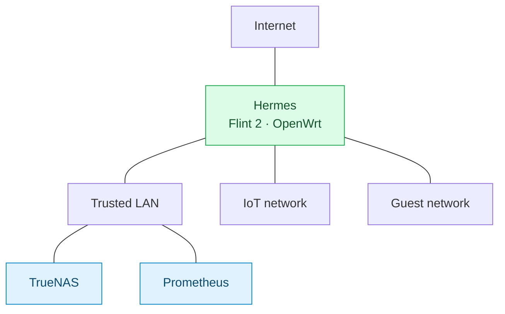
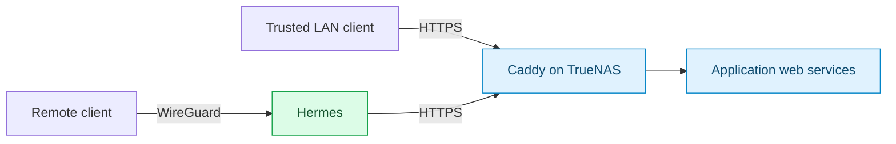

# Networking and access

> [Homelab](../README.md)

I use Hermes, a GL.iNet Flint 2 running OpenWrt, as my main router. It handles the trusted, IoT, and guest networks, local DNS, and WireGuard access from outside the house. Caddy on TrueNAS handles private HTTPS for my web apps.

## Network layout

This shows how the networks fit together, rather than the physical wiring. I haven't documented the switch-port assignments or detailed firewall rules between networks. Printer and TV-to-Jellyfin access requirements, including device addresses, network placement, and the required firewall rules, are also not documented here.

Prometheus currently prefers Ethernet over Wi-Fi. These are the last recorded Ubuntu settings; its planned gaming OS has not been installed.

Addresses, ports, and routing

| Component | Configuration |
| --- | --- |
| Internet | 2 Gb/s fiber |
| Router | Hermes at `10.10.10.1`, running OpenWrt |
| Trusted LAN | `10.10.10.0/24`; TrueNAS and Prometheus are on this network |
| IoT network | `10.10.20.0/24` |
| Guest network | `10.10.30.0/24` |
| TrueNAS | `10.10.10.10` |
| Prometheus | Ethernet DHCP reservation `10.10.10.20`; preferred route metric 100 |
| Prometheus fallback | Wi-Fi, dynamic address, route metric 600 |
| Switch | TP-Link unmanaged eight-port 2.5 GbE switch |

### Ethernet preference and Wi-Fi fallback

The recorded Ubuntu configuration uses lower route metrics to prefer Ethernet (100) over Wi-Fi (600) when both routes are available. These host settings do not automatically carry over to Windows.

The Prometheus Ethernet link negotiated 2.5 Gb/s full duplex. I haven't measured end-to-end throughput; the link speed and fiber service alone don't establish it.

## Local and remote service access

When I open a `home.arpa` address, Hermes resolves the name to Caddy. Caddy accepts the HTTPS connection and passes the request to the right app. That is its job as a reverse proxy.

Away from home, I connect through WireGuard on Hermes. Immich, Bitwarden, and DAVx5 work on my phone through the same private URLs.

WireGuard is separate from the outbound Gluetun/PIA VPN used by qBittorrent. See [download VPN behavior](services.md#qbittorrent-and-vpn-behavior) for that path.

## DNS, certificates, and proxy routes

My devices need to trust Caddy's public root certificate. Its existing CA state needs to stay intact during maintenance; only the public root certificate belongs on clients. Caddy adds no authentication of its own, so each app still controls access.

DNS, certificates, upstreams, and published ports

### Service names and certificate trust

The [Caddyfile](../caddy/Caddyfile) is the reference for service names and upstream destinations. Local DNS must resolve those names to Caddy. Each site uses `tls internal`: Caddy's own certificate authority (CA) issues the HTTPS certificates, so clients must trust Caddy's public root certificate. Preserve the existing CA state during maintenance; only the public root certificate belongs on clients.

### Backend connections

An upstream is the backend destination Caddy contacts after receiving a client request. Most application upstreams are HTTP on TrueNAS. Crafty's upstream and the OpenWrt administration upstream use HTTPS with upstream certificate verification disabled in the current source. Nextcloud also has CardDAV/CalDAV discovery redirects to `/remote.php/dav/`.

Besides application routes, Caddy serves the TrueNAS and OpenWrt administration interfaces and a diagnostic text endpoint. Exact names, destinations, and published ports are in the Caddyfile and [Caddy stack](../caddy/compose.yaml).

### Published ports and authentication

| Connection | Current configuration |
| --- | --- |
| HTTPS to Caddy | TCP 443 is published; use explicit HTTPS URLs |
| HTTP redirects | Host port 80 is not published |
| HTTP/3 | UDP 443 is not published |
| Direct application access | Application ports remain published independently |

Caddy adds no authentication of its own. Access controls depend on each application's settings.

I ran into a case where a route was visible in the editor but missing inside Caddy. The [troubleshooting notes](troubleshooting.md#caddy-route-present-on-host-but-missing-in-container) show how I compared the files.

