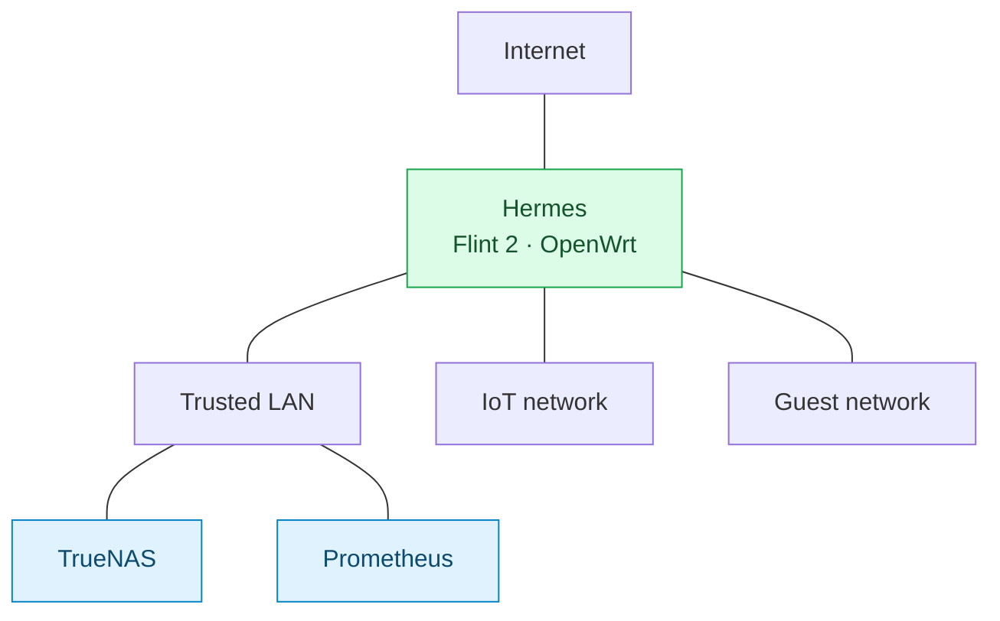
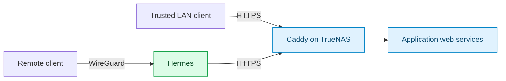

# Networking and access

> [Overview](../README.md) · [Infrastructure](infrastructure.md) · [Services](services.md) · [Operations](operations.md) · [Roadmap](roadmap.md)

Hermes, a GL.iNet Flint 2 running OpenWrt, is the main router. It provides three working networks, local DNS, and WireGuard remote access. Caddy on TrueNAS provides private HTTPS for the web applications.

## Network layout

This is a logical layout. Physical switch-port assignments and detailed inter-network firewall rules have not yet been documented.

| Component | Configuration |
| --- | --- |
| Internet | 2 Gb/s fiber |
| Router | Hermes at `10.10.10.1`, running OpenWrt |
| Trusted LAN | `10.10.10.0/24`; TrueNAS and Prometheus are on this network |
| IoT network | `10.10.20.0/24` |
| Guest network | `10.10.30.0/24` |
| TrueNAS | `10.10.10.10` |
| Prometheus | Ethernet DHCP reservation `10.10.10.20`; preferred route metric 100 |
| Prometheus fallback | Wi-Fi, dynamic address, route metric 600 |
| Switch | TP-Link unmanaged eight-port 2.5 GbE switch |

The Prometheus Ethernet link negotiated 2.5 Gb/s full duplex. Link speed and the fiber plan do not establish end-to-end throughput; that still needs measurement.

## Local and remote service access

Clients resolve `home.arpa` service names through Hermes and connect to Caddy over HTTPS. Away from home, WireGuard on Hermes provides access to the private services. Immich, Bitwarden, and DAVx5 work on my phone through these URLs.

WireGuard is separate from the outbound Gluetun/PIA VPN used by qBittorrent. See [download VPN behavior](services.md#qbittorrent-and-vpn-behavior) for that path.

## DNS, certificates, and proxy routes

The [Caddyfile](../caddy/Caddyfile) is the reference for service names and upstream destinations. Local DNS must resolve those names to Caddy. Each site uses `tls internal`, so clients must trust Caddy's public root certificate. Preserve the existing CA state during maintenance; only the public root certificate belongs on clients.

Most application upstreams are HTTP on TrueNAS. Crafty's upstream and the OpenWrt administration upstream use HTTPS with upstream certificate verification disabled in the current source. Nextcloud also has CardDAV/CalDAV discovery redirects to `/remote.php/dav/`.

Besides application routes, Caddy serves the TrueNAS and OpenWrt administration interfaces and a diagnostic text endpoint. Exact names, destinations, and published ports are in the Caddyfile and [Caddy stack](../caddy/compose.yaml).

Only TCP 443 is published by that stack: use explicit HTTPS URLs. Host port 80 redirects and UDP 443 for HTTP/3 are not published. Application ports remain published independently, and Caddy adds no authentication of its own. Access controls depend on each application's settings.

If a route is present in the editor but absent from the running proxy, use the [container-file diagnostic](operations.md#caddy-route-present-on-host-but-missing-in-container). The [roadmap](roadmap.md#network-follow-ups) tracks firewall documentation, throughput tests, and device-access questions.
