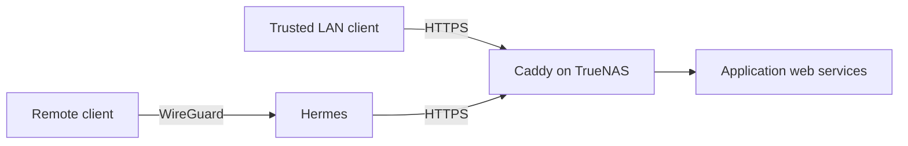

# Services and clients

[Overview](../README.md) · [Infrastructure](infrastructure.md) · [Operations](operations.md) · [Backups](backups.md) · [Roadmap](roadmap.md)

The repository contains 15 Compose stacks managed through TrueNAS Apps. This reference covers their purpose, ports, storage, and clients. Use each linked Compose file for image versions and deployment settings; application-specific runtime configuration stays in external storage.

## Application reference

All web names below end in `.home.arpa` and appear in the [Caddyfile](../caddy/Caddyfile). Port mappings are **host → container** from the corresponding Compose source. Some mappings bind explicitly to `10.10.10.10`; others omit a host address. Consult the source before assessing listening scope.

| Stack source | Purpose | Web hostname | Published web port | State and dependencies |
| --- | --- | --- | --- | --- |
| [Actual Budget](../actual-budget/compose.yaml) | Personal budgeting and SimpleFIN imports | `actual-budget` | `31012 → 5006` | `appdata/actual-budget` |
| [Audiobookshelf](../audiobookshelf/compose.yaml) | Purchased audiobook library | `audiobookshelf` | `30067 → 80` | Configuration/metadata in appdata; books in shared media |
| [Caddy](../caddy/compose.yaml) | Private HTTPS reverse proxy | Per-service names | `443 → 443` TCP | External CA/runtime state; repository Caddyfile |
| [code-server](../code-server/compose.yaml) | Browser editor and Git workspace | `code-server` | `32443 → 8443` | Editor state/auth in appdata; stacks mounted at `/workspace` |
| [Crafty 4](../crafty-4/compose.yaml) | Minecraft server management | `crafty-4` | `30146 → 8443` | Config, servers, imports, logs, backups in appdata |
| [Immich](../immich/compose.yaml) | Photo and video archive | `immich` | `30041 → 30041` | PostgreSQL/VectorChord, Valkey, OpenVINO ML image; photos in `data/photos` |
| [Jellyfin](../jellyfin/compose.yaml) | Movies and TV | `jellyfin` | `30013 → 8096` | Config in appdata; read-only shared media |
| [Joplin Server](../joplin/compose.yaml) | Notes synchronization service | `joplin` | `30106 → 30106` | PostgreSQL; Joplin clients sync here |
| [LubeLogger](../lubelogger/compose.yaml) | Truck maintenance, modifications, and fuel | `lubelogger` | `30035 → 30035` | PostgreSQL, app files, data-protection keys |
| [Navidrome](../navidrome/compose.yaml) | Music library | `navidrome` | `30043 → 4533` | State in appdata; read-only `media/music` |
| [Nextcloud](../nextcloud/compose.yaml) | Files, calendar, contacts, bookmarks | `nextcloud` | `30027 → 80` | Custom FFmpeg image, cron, PostgreSQL 17, Valkey; files in `data/files` |
| [Open WebUI](../open-webui/compose.yaml) | Interface to local models | `open-webui` | `30070 → 8080` | Persistent backend data and external secret file; Ollama integration disabled in source |
| [qBittorrent + Gluetun](../qbittorrent/compose.yaml) | Downloads through PIA | `qbittorrent` | `33080 → 33080` via Gluetun | Shared network namespace; config/VPN state in appdata; torrent data in media |
| [SearXNG](../searxng/compose.yaml) | Metasearch | `searxng` | `34053 → 8080` | External settings and cache |
| [Vaultwarden](../vaultwarden/compose.yaml) | Password vault | `vaultwarden` | `30032 → 30032` | PostgreSQL plus vault data in appdata |

Crafty also publishes `8100` and TCP `25500–25600`. PostgreSQL and cache services have no host port publications in these stacks. Image tags/digests and complete volume definitions remain in Compose rather than being duplicated here.

## Caddy, DNS, and trust

Clients resolve `home.arpa` service names through Hermes and connect to Caddy over HTTPS. Remote clients reach the private services through WireGuard on Hermes.

Caddy's source uses `tls internal` for every site. Client DNS must resolve the configured names to the proxy, and clients must trust its public root certificate. CA private keys and runtime state remain under `/mnt/tank/appdata/caddy/data`; the configuration also persists `/mnt/tank/appdata/caddy/config`.

In addition to the application routes above, the Caddyfile contains:

| Name | Configured action |
| --- | --- |
| `test.home.arpa` | Diagnostic text response |
| `truenas.home.arpa` | Proxy to `http://10.10.10.10:80` |
| `openwrt.home.arpa` | Proxy to `https://10.10.10.1` |

Application upstreams use `10.10.10.10` and the host ports in the table. Crafty's upstream is HTTPS; other application upstreams are HTTP. Crafty and OpenWrt explicitly skip upstream TLS verification in the source. Nextcloud has CardDAV/CalDAV discovery redirects to `/remote.php/dav/`.

Only TCP 443 is published by the Caddy stack. Use explicit HTTPS URLs; its Compose definition publishes neither host port 80 for redirects nor UDP 443 for HTTP/3. Backend application ports remain published independently, and Caddy adds no authentication. Immich, Bitwarden, and DAVx5 work on my phone through the `home.arpa` HTTPS URLs.

Names such as `code.home.arpa`, `search.home.arpa`, and `torrents.home.arpa` are historical aliases, superseded by the service names in the current source. For a route that appears in the editor but not in Caddy, see [the container-file diagnostic](operations.md#caddy-route-present-on-host-but-missing-in-container).

## External configuration

Real secrets and runtime configuration stay outside Git. The repository references these files without including their contents:

| Stack | External files under `/mnt/tank/appdata/` |
| --- | --- |
| code-server | `code-server/auth.env` |
| qBittorrent/Gluetun | `qbittorrent/pia.env` |
| Joplin | `joplin/postgres.env`, `joplin/joplin.env` |
| LubeLogger | `lubelogger/postgres.env`, `lubelogger/lubelogger.env` |
| Vaultwarden | `vaultwarden/postgres.env`, `vaultwarden/vaultwarden.env` |
| Nextcloud | `nextcloud/secrets/{nextcloud,cron,postgres,redis}.env` |
| Immich | `immich/secrets/{server,machine-learning,pgvecto,redis}.env` |
| Open WebUI | `open-webui/secrets/open-webui.env` |

The brace notation summarizes separate filenames. SearXNG's settings and secret key live in its external configuration directory. Application listen ports, public URLs, proxy trust, and authentication can depend on those runtime settings; publishing a Compose file alone does not capture them.

Nextcloud builds [its custom image](../nextcloud/Dockerfile) with FFmpeg. Its cron service shares the app's HTML/data mounts. The Compose file's cutover comment dates from the completed migration; use an application-specific synchronization and database plan for any future move.

## qBittorrent and VPN behavior

qBittorrent shares Gluetun's network namespace. Gluetun publishes the Web UI on `10.10.10.10:33080`, permits that input port, and obtains a separate torrent listening port through PIA. The up/down hooks call qBittorrent's loopback API, selecting the VPN interface on forwarding startup and loopback on teardown. The Web UI port and dynamic torrent port serve different purposes.

Migration checks verified matching VPN egress, a qBittorrent listening port matching PIA's assignment, and `tun0` selected. The hooks use localhost authentication bypass in the shared namespace. Keep LAN authentication and Web UI protections intact; replace and test the hooks before changing loopback authentication. After a VPN change, verify downloads, seeding, and port-forwarding recovery.

The old `FIREWALL_OUTBOUND_SUBNETS` exception for `192.168.4.124/32` has been removed. Its original integration purpose is unknown; any new exception should have a specific, tested requirement.

Compose environment changes take effect when the app is recreated through TrueNAS. Coordinate qBittorrent with Gluetun because it shares that namespace, and allow for interrupted downloads.

## Media storage

| Host source | Container use in the repository |
| --- | --- |
| `data/media/audiobooks` | Audiobookshelf's preserved library destination `/mnt/tank/Apps/audiobookshelf/audiobooks` |
| `data/media/music` | Navidrome `/music`, read-only |
| `data/media` | Jellyfin `/media`, read-only |
| `data/media/torrents` | qBittorrent `/data/torrents` |

These host paths are beneath `/mnt/tank`. Audiobookshelf's internal path is intentional; changing it can invalidate stored library references. New movies, TV, and torrent paths should remain ordinary directories in the shared media dataset where hardlinks are intended. A common container `/data` layout for a future *Arr stack is a proposal, not the current qBittorrent mount. No *Arr stack is deployed.

## Clients and integrations

On GrapheneOS/Android, I use Lissen for audiobooks, Navic for music, AFinity for Jellyfin, qBitController for downloads, Immich for photo uploads, and Bitwarden for Vaultwarden. I used OpenAudible to prepare purchased audiobooks. Immich, Bitwarden, and DAVx5 work through private HTTPS.

Nextcloud is used for files, DAVx5 calendar/contacts, and floccus bookmarks. Joplin holds class, personal, and professional Markdown notes and now syncs through Joplin Server. Nextcloud is no longer its sync target.

[LubeLogger-Android](https://github.com/AldogPlays/LubeLogger-Android) is the client I built for my own truck records. Actual Budget uses SimpleFIN imports. Its [bank-sync script](../actual-budget/scripts/actual-bank-sync.sh) reads an external environment file and mounted password file, with a daily midnight cron job running as root. Fidelity/SimpleFIN compatibility remains an integration item to check.

## Remote access and retired services

WireGuard on Hermes provides remote access. AdGuard Home, Tailscale, File Browser, Jackett, and FlareSolverr are no longer used. Their appearance in migration logs describes the previous setup; they are not dependencies of the current service list. Gluetun/PIA remains qBittorrent's outbound VPN and serves a separate purpose from remote-access WireGuard.
