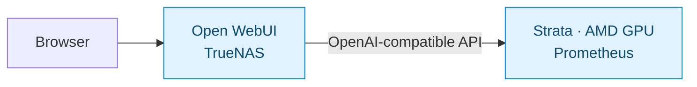

# Local AI

> [Homelab](../../README.md) · [Documentation](../README.md) · [Operations](../operations/README.md)

The local AI setup has two parts: **Open WebUI** on TrueNAS provides the browser interface, and **Strata** on Prometheus runs the model and generates responses using the AMD GPU. The current model is `qwen3.8-flash-next-q2_0`, configured with a 65,536-token (64K) context window. Startup after reboot has been verified.

**On this page:** [Serving layout](#serving-layout) · [Performance](#performance-reference) · [Runtime](#runtime-and-maintenance)

## Serving layout

Open WebUI connects to Strata through `/v1/models` and `/v1/chat/completions`. The [WebUI stack](../../open-webui/compose.yaml) persists its backend data, disables Ollama integration, and is served through Caddy. [Networking](networking.md) covers client access and Ethernet/Wi-Fi routing; [infrastructure](infrastructure.md#prometheus-ai-host) records the hardware.

Here, “OpenAI-compatible” describes the API format used between the two services. Strata performs the inference on Prometheus. `/v1/models` lists available models, and `/v1/chat/completions` accepts chat requests.

Three settings describe different parts of this setup:

| Term | Meaning here |
| --- | --- |
| Q2_0 | The quantization label for the model being served. Quantization stores model weights at reduced precision; the recorded benchmark does not compare its quality with other quantizations. |
| 64K context | The configured token window for a request. Tokens are chunks of text, so 65,536 tokens is not a word count. A configured window does not establish how well the model uses all of it. |
| Thinking enabled | The model generates reasoning as well as visible answer text. That reasoning consumes generated tokens and time before or alongside the answer. |

## Performance reference

The [standard Q2_0 benchmark](../benchmarks/q2-0.md) records the measured timings, output limits, sanity checks, run configuration, and command for repeating the test. It is the single performance baseline for this setup.

## Runtime and maintenance

These are recorded setup values; check the running versions after updates. The Strata image uses a moving tag. Its full Compose definition is managed on Prometheus, outside this repository.

| Item | Configuration |
| --- | --- |
| Host OS / kernel | Ubuntu Server 26.04.1 LTS / `7.0.0-42-generic` |
| Docker / Compose | Docker CE 29.9.2 / Compose 5.7.0 at installation |
| Strata image / engine | `ghcr.io/niko1221/strata:latest-rocm-gfx110x` / engine 0.1.55 HIP in logs |
| Model / context | `qwen3.8-flash-next-q2_0` / 65,536 tokens |
| Capabilities | Text-only; vision disabled; Bearer API authentication |
| OpenAI-compatible base URL | `http://10.10.10.20:8080/v1` |

### Storage and configuration

| Prometheus path | Role |
| --- | --- |
| `/srv/ai/strata/compose.yaml` | Host-side deployment definition |
| `/srv/ai/strata/data` | Models, packed experts, draft layers, and runtime state; mounted at `/data` |
| `/etc/systemd/system/strata-compose.service` | Host-managed Compose startup unit |

The dedicated logical volume (LV), formatted with ext4, is mounted persistently at `/srv/ai`; the remaining volume-group space was left unallocated.

Engine logs are at `/data/state/strata/launch/docker.engine.log` inside the container. Authentication is supplied through an existing protected mount referenced by the host-side configuration; keep its contents out of logs and documentation.

The recorded container settings are:

| Area | Settings |
| --- | --- |
| Model selection | `FAMILY: qwen`, `MODEL: Q2_0` |
| Context and input | `CONTEXT: "64k"`, `VISION: "off"` |
| Authentication | `API_KEY_FILE` references the mounted credential file |
| AMD GPU access | `/dev/kfd`, `/dev/dri`, and video/render groups `44` and `991` |
| Memory | 2 GB shared memory; unlimited memlock |
| Shutdown and logs | 120-second stop grace period; bounded JSON-file logs |
| API publication | Ethernet address, TCP 8080 |

The 64K setting allocates context space. The standard suite's longest performance prompt was approximately 16K, so the recorded benchmark does not establish full-window answer quality.

### Startup and diagnostics

The systemd unit waits for the reserved Ethernet address on `enp13s0`, then invokes Compose with `up -d --force-recreate`. Both manual startup and startup after reboot have succeeded.

Hardware power-outage recovery and recovery from an unhealthy-but-running process still need separate verification.

For a healthy model with an unreachable host API, use [Prometheus diagnostics](../operations/troubleshooting.md#prometheus-healthy-container-unreachable-api). For responses that appear late in the browser, compare backend completion with [Open WebUI timing](../operations/troubleshooting.md#open-webui-replies-appear-late).

The earlier Windows-to-Ubuntu move, SMT fix, and Netplan changes are recorded in [migration history](../history/migrations.md#prometheus-move-to-ubuntu).
